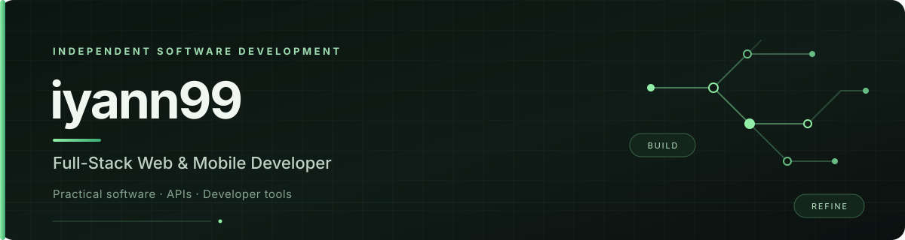
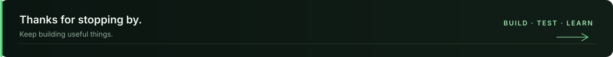

  

  
  
  

I build practical software with a focus on backend systems, REST APIs, and developer tools. I enjoy experimenting, solving engineering problems, and learning by building.

### Focus
- **Backend:** PHP, Laravel, REST APIs, authentication, and database design.
- **Web & mobile:** JavaScript, React, Next.js, HTMX, Dart, and Flutter.
- **Beyond the stack:** Go, software security, and system architecture.

### Featured Project
**[SwitchLens](https://github.com/iyann99/SwitchLens)** — An open-source media explorer that brings multiple image sources into one interface.

[Live demo](https://switchlens.vercel.app) · [Source code](https://github.com/iyann99/SwitchLens)

### Tech Stack

**Data & tools:** MySQL · MariaDB · PostgreSQL · SQLite · Supabase · Git · Postman · Termux

### GitHub Stats

  
  

  <a href="https://saweria.co/iyann99">Support my independent development on Saweria</a>

  

